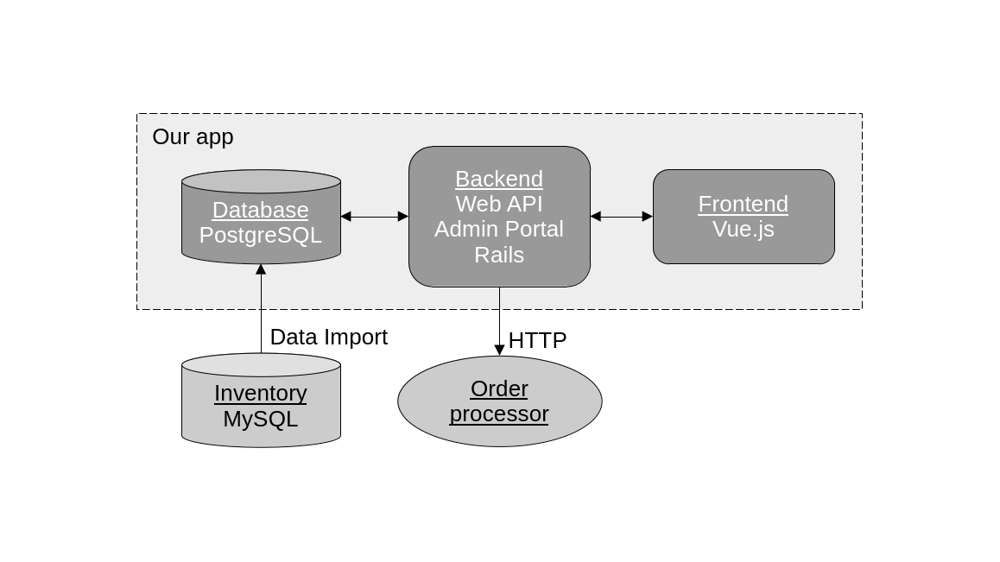
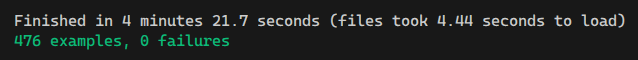
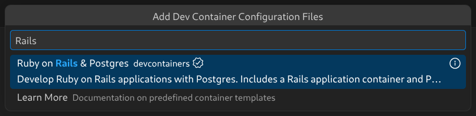

[Rails](https://rubyonrails.org/) upgrades can be hard, especially when jumping through multiple major versions. Conventions change, APIs get deprecated, core gems get updated, and third-party gems get abandoned. Things can get out of hand rather quickly if the work isn't done carefully. [Rails' own guide for upgrading](https://guides.rubyonrails.org/upgrading_ruby_on_rails.html) recommends a conservative, step-by-step approach: make sure you have good test coverage, keep in mind the Ruby versions that each version of Rails requires, and upgrade Rails little by little. Upgrade to the latest patch release of your current version, fix the issues that come up, then upgrade to the latest patch release of the next minor version. Keep doing that until you reach the target version. This is hard work.

But there's another option. We can create a brand new Rails project using the latest version, and port the old code into the new project. File by file, feature by feature. This approach also has its issues, and can sometimes actually be harder. But sometimes, given the correct conditions, it can produce a better outcome.

We recently went through this exercise for a Rails project that we inherited. It was written in 2018, ran Rails 5, and we were tasked with bringing it into the modern era. A lot had changed in Rails, so a lot had to change in this app. In this article, I'll share my experience doing that work.

## An overview of the project



First, let's describe the system. This application is a web-based B2B e-commerce site. The site allows customers to browse a catalog of products, construct a shopping cart, and place orders. For the catalog, the source of data is an external inventory system. Through a separate data import process, the inventory data gets copied into our site's internal database. There is also an external order processing system. When orders are placed on our site, a backend job kicks in to submit them to this external order processing system via its web API.

The site itself has four main runtime components: a backend, built with Rails 5, which exposes a web API using the [JSON:API protocol](https://jsonapi.org/); a frontend written with [Vue.js version 2](https://v2.vuejs.org/); an admin portal built with the [ActiveAdmin](https://activeadmin.info/docs/v3/) gem; and a [PostgreSQL](https://www.postgresql.org/) database.

## Porting into a fresh codebase instead of doing an in-place upgrade

Both approaches involve a considerable amount of work. However, Rails' official documentation recommends small, incremental upgrades supported by a solid foundation of automated tests, and that method is undeniably safer. For this project, though, it made sense to go with the more daring approach for various reasons.

The first issue with this codebase was that test coverage was very limited. There were only a few tests exercising some of the core domain logic, which was wholly insufficient for attempting an upgrade like this. We did not have the safety net in place to carry us through many small upgrades. Or any kind of upgrade, for that matter. Regardless of the path we took, building a test suite with good coverage was a necessity.

We also weren't familiar enough with this codebase. In my estimation, performing this upgrade by porting the code into a fresh Rails project would force us to gain intimate knowledge of the code: its core parts, how its main features were implemented, and what libraries and framework features were being used. Of course, as we already discussed, we had virtually no test coverage, so the process of writing these tests would also help us develop this understanding.

There was also the issue that the project was using Rails 5, and we wanted to upgrade it to Rails 8. Rails 8 is very different from Rails 5. Many conventions have changed, many framework features have been deprecated, and many gems are now incompatible or have been replaced. Many of the recommended ways of doing things have also changed. Most notably, the [JavaScript story](https://guides.rubyonrails.org/working_with_javascript_in_rails.html) changed dramatically during that time. New frameworks like [Hotwire](https://hotwired.dev/) have emerged and become the standard. The way to interact with [the asset pipeline](https://guides.rubyonrails.org/asset_pipeline.html) to bundle and serve static assets has been greatly overhauled. Modern web-native technologies have been embraced.

Upgrading from a Rails 5 base meant carrying a lot of baggage, fighting against the framework at every step, looking for backports and alternatives of features and gems. We would pay a great price in order to properly get rid of the Rails 5 way of doing things; or risk ending up with a Rails 8 app only in name, if the Rails 5 conventions were allowed to persist.

## The upgrade plan

With all this in mind, a plan began to form for how to approach this upgrade. Here's a bird's-eye view of that plan:

1. Review and understand the code and the dependencies.
2. Develop a comprehensive test suite.
3. Set up the new project.
4. Transplant the backend code files.
5. Set up frontend asset bundling.
6. Set up the Admin Portal and transplant its code files.
7. Port the frontend.

## 1. Review and understand the code and the dependencies

As I mentioned before, when we started this project, we did not have a thorough understanding of how it was built. So the first step was to review it and gain that understanding. Specifically, we needed to know the main building blocks, which framework features and libraries were being used, and where it deviated from the usual Rails conventions.

Here's what we learned:

The codebase was a Rails 5 application with a backend (which exposed a web API), a frontend built with [Vue.js 2](https://v2.vuejs.org/), a [PostgreSQL](https://www.postgresql.org/) database, and an admin portal powered by [ActiveAdmin](https://activeadmin.info/docs/v3/). The frontend lived in the same codebase and was part of the Rails project. As such, asset bundling was handled by Rails itself via [Webpacker](https://github.com/rails/webpacker).

The backend was mostly a conventional Rails web API. It had models, controllers, mailers, and jobs. It also used [Action Cable](https://guides.rubyonrails.org/action_cable_overview.html) for real-time bidirectional communication with clients and the [ActiveInteraction](https://github.com/aaronlasseigne/active_interaction) gem to implement service objects that contained most of the domain logic. The app also supported image uploads and light preprocessing with [CarrierWave](https://github.com/carrierwaveuploader/carrierwave) and [MiniMagick](https://github.com/minimagick/minimagick). All of these can move forward to Rails 8 without too much trouble.

```txt
app/
├── admin
├── assets
├── channels
├── controllers
├── helpers
├── interactions
├── javascript
├── jobs
├── mailers
├── models
├── resources
├── uploaders
└── views
```

For jobs, it used [Delayed::Job](https://github.com/collectiveidea/delayed_job) as the [Active Job](https://guides.rubyonrails.org/active_job_basics.html) backend. It also had [cron-style recurring jobs](https://en.wikipedia.org/wiki/Cron), implemented using the [Delayed::Cron::Job](https://github.com/codez/delayed_cron_job) gem. While this is a perfectly valid setup for Rails 8, there is a newer alternative. [Solid Queue](https://github.com/rails/solid_queue) is a built-in Active Job backend that comes out of the box with support for cron-style recurring jobs, so this was something we'd want to modernize.

The biggest aspect of the backend was the style of API it used and how it was built. This API used the [JSON:API protocol](https://jsonapi.org/) and was implemented using the [Graphiti](https://graphiti.dev/) gem. This gem is used to define "[resources](https://graphiti.dev/concepts/resources)": classes that define the structure and querying behavior for related models and, when exposed through Rails controllers, provide a series of API endpoints that clients can access using JSON:API.

As a result, the controllers in this Rails backend were trivial and repetitive. All they did was delegate to these resource classes, and they all looked pretty much the same.

The resource classes were the ones that had the actual logic:

```rb
class CategoryResource < ApplicationResource
  self.type = :categories
  self.model = Category

  attribute :name, :string
  attribute :names, :array_of_strings
  attribute :parent_id, :string

  filter :id, :string

  filter :is_root, :boolean, single: true do
    eq do |scope, value|
      scope.main if value != false && value != 'false'
    end
  end

  filter :parent_id, :string, single: true do
    eq do |scope, value|
      scope.level2.where(parent_id: value)
    end
  end

  has_many :children,
    scope: -> { Category.all },
    resource: CategoryResource,
    foreign_key: :parent_id
end
```

This was the first big risk: this gem was responsible for implementing a major part of our system, the backend API. We had to figure out if it was still maintained, whether it worked with the latest versions of Ruby and Rails, and whether its functionality, configuration, or API had changed. Luckily for us, the gem was still alive and well. Although it had changed, the changes were minimal and well documented. Nonetheless, this was one aspect that needed to be addressed in our modernization project.

Another major gem used in this codebase was [Devise](https://github.com/heartcombo/devise), a venerable library in the Rails world and the de facto standard for implementing authentication. So there's no risk of deprecation for this one. However, that's not the whole authentication story for this app. It also used [Knock](https://github.com/nsarno/knock), a gem for implementing [JWT](https://en.wikipedia.org/wiki/JSON_Web_Token) authentication for Rails APIs. The Knock project has been abandoned, and its author recommends against using it. Instead, they recommend rolling out one's own JWT-based authentication using Ruby's [JWT](https://github.com/jwt/ruby-jwt) gem directly. This means we would have to rework the authentication system. To keep the scope of the changes limited and avoid unnecessarily breaking the frontend, we decided to keep using JWT; it would just work differently under the hood. Another interesting thing is that this app had a manual integration between Knock, Devise, and Rails controller helpers like `current_user`. We would have to implement that as well in the new Rails 8 codebase.

The final major piece of the backend to consider was the Admin Portal. As mentioned before, it used the [ActiveAdmin](https://activeadmin.info/docs/v3/) gem. Thankfully, this was not an issue because the gem is still well maintained and can be upgraded fairly cleanly to a more recent version. The issue was its frontend logic. The Admin Portal did have a traditional server-rendered GUI, however, it was augmented with a fair bit of JavaScript using [jQuery](https://jquery.com/) and various other libraries, including [jQuery UI](https://jqueryui.com/), [Select2](https://select2.org/), and [CKEditor](https://ckeditor.com/). Moreover, all the frontend code was written in [CoffeeScript](https://coffeescript.org/), which Rails 5 supported out of the box. This is no longer the case in newer versions of Rails, so we'd have to rewrite that code in plain old JavaScript. CoffeeScript's out-of-the-box support also meant that it was transpiled via Rails' asset pipeline, not Webpacker, as the user-facing frontend was. We would also need to address that. Preferably, we'd use the same bundling and transpilation mechanism for all frontend code instead of this hybrid approach.

## 2. Develop a comprehensive test suite

That initial analysis gives us a pretty clear picture of what we're dealing with. Before we start migrating any code, though, we need a safety net. Automated tests will provide that safety net. As I mentioned before, this codebase had barely any test coverage, which was a non-starter. Traditionally, developing a comprehensive test suite in preparation for an upgrade such as this can be very expensive. Luckily for us, this is an area where AI-assisted development can be a great help. The AI coding agent needs to be carefully directed to produce meaningful tests and to help us develop the strong sense of ownership and understanding of the codebase that we've been missing. Here's how we went about it.

One good thing about this project is that it follows the conventional Rails file structure. This means models, controllers, jobs, mailers, and so on are grouped in their own directories, follow a similar structure, and are where you'd expect them to be. So we can easily plan to develop this test suite from the bottom up. We start by writing tests for more standalone, lower-level classes like models and mailers; then work our way up the hierarchy to interactions and jobs, then the Graphiti resources and API endpoints, and finally to higher-level system tests that simulate user interactions in a real web browser.

Now, we don't just ask our AI agent, "Please write tests for this project's models." Instead, we first pick a class, review and understand it, identify the aspects worth testing, devise testing strategies, and write a few tests by hand. These initial tests serve as a blueprint for the others. They are exemplary and establish the style and structure of the test suite. The point is that we can then have the AI agent look at them as examples so it knows how to do the work. We do this for each type of class: models, mailers, interactions, resources, and so on. We lay the foundation and lean on the AI agent to finish the job. This way, we can write prompts like these:

> Please write tests for this model/mailer/interaction/etc. Follow the style and patterns used in this and that file. Focus on exercising this and that feature.

We repeat this for every class and every layer, including a mix of unit, integration, and system tests, and always review the output. Eventually, we end up with a comprehensive test suite. With this simple recipe, we were able to get good, consistent results without too much manual intervention. We ended up with a comprehensive test suite as if we had written it ourselves, which was exactly the point. We also gained a deeper understanding of the codebase.



## 3. Set up the new project

Now that we have a solid test suite, we can turn to the new project, starting with setting up a development environment. Thanks to [Visual Studio Code](https://code.visualstudio.com/) and [Development Containers](https://containers.dev/), it's now very easy to get a fully featured, containerized development environment with Ruby, Rails, and PostgreSQL. Of course, we pick the latest versions of all of them.



The defaults we get via `New Dev Container...` and the `Ruby on Rails & Postgres` template are a great foundation. The only tweak we have to make is to ensure the Development Container has the software the app needs. So we include this in the Dockerfile:

```dockerfile
# ...

# Here, we configure the PostgreSQL apt repository so that we can install psql down below...
RUN apt update && apt install -y postgresql-common
RUN YES=yes /usr/share/postgresql-common/pgdg/apt.postgresql.org.sh

# Here is where we install the CLI client for PostgreSQL. We also install chromium and chromium-driver, which are
# necessary for our system tests. We also install ImageMagick, which is necessary for the image processing
# this app does.
RUN apt update && export DEBIAN_FRONTEND=noninteractive \
    && apt install -y --no-install-recommends postgresql-client-18 default-mysql-client imagemagick chromium chromium-driver

# ...
```

With this, we have the perfect development and runtime environment for our new project.

Now we need to create a new Rails project. Not much to go over here. We connect to our Development Container and run this command:

```sh
rails new . -d postgresql --skip-hotwire --skip-js
```

Three interesting things about this:

1. We use `-d postgresql` to specify that the app's database will be PostgreSQL.
2. We use `--skip-hotwire` because this app will have a Rails API backend with a Vue.js frontend, and Hotwire is designed to work with classic server-side rendering using Rails `.erb` views.
3. We use `--skip-js` because we will not use any of Rails' built-in options for JavaScript bundling. We will use [Vite](https://vite.dev/). More on that later.

## 4. Transplant the backend code files

This is the big one. Now that we have an empty, running Rails web app, we need to port all the old code. "Porting" is not simply copying and pasting, of course. We will also change the code as needed to adopt the newer Rails 6 conventions. This is a modernization project, after all.

The approach will be similar to how we wrote the test suite: we will move files from the bottom up, layer by layer. As we go, we will add any third-party dependencies that are needed, move over the related automated tests, run them or otherwise test as best we can, and fix any resulting issues. Like many codebases, this one's layers are not cleanly separated. So sometimes there will be surprises about which components communicate with one another. Sometimes we will have to bring in unexpected dependencies from other layers or temporarily comment them out just so that the project "builds." The troubleshooting aspect of this is an area where AI coding agents are very helpful, especially when figuring out bugs caused by library and framework version changes.

Anyway, we start with the database migrations. The process is simple: we copy them over one by one and run `bin/rails migrate` after each one. This worked well for us, with a couple of small hiccups. As I mentioned before, this app uses Devise for authentication, so we immediately run into the old Devise migration that creates the user accounts table. Instead of copying that one over, we install the Devise gem into our new project and follow the official instructions to configure it. We end up with our first migration. We continue and run into another gem that we need: [Scenic](https://github.com/scenic-views/scenic). It allows versioning of database views, which this app makes heavy use of. So we install it, copy the various SQL files containing the view definitions maintained by Scenic, and continue copying and running the migrations. Before long, we're done, and the new project's database structure mirrors the old one's.

Next, we move on to the models and CarrierWave uploaders. Here we also have to bring in some additional classes from the app's `lib` directory that the models depend on. To support the uploaders, we install the CarrierWave gem. At this point, we can bring in the tests for the models and uploaders to verify that they are working.

Here we discover a few bugs. The first is due to changes in how CarrierWave's ImageMagick-powered image processing features work. Thankfully, it's simple to fix:

```diff
class ImageUploader < CarrierWave::Uploader::Base
  include CarrierWave::MiniMagick

  storage :file

  version :web do
-    process resize_to_fill: [ -1, 450 ]
+    process resize_to_fit: [ nil, 450 ]
  end

  version :small do
-    process resize_to_fill: [ -1, 150 ]
+    process resize_to_fit: [ nil, 150 ]
  end
end
```

Another is related to `active_record_upsert`, a gem that this app uses to perform upserts. It does not work in Rails 8, so the functionality needs to be reimplemented using built-in Active Record features. Again, thankfully, the fix is simple:

```diff
class InventoryItem < ApplicationRecord
-  upsert_keys :title, :inventory_item_id
+  def self.upsert!(params)
+    upsert(params, unique_by: [ :inventory_item_id, :title ])
+    find_by!(inventory_item_id: params[:inventory_item_id], title: params[:title])
+  end
end
```

Another bug had to do with changes to the syntax for defining enums:

```diff
class Order < ApplicationRecord
-  enum status: [ :initial, :sent, :cancelled, :initial_stuck ]
+  enum :status, [ :initial, :sent, :cancelled, :initial_stuck ]
end
```

Another bug is due to the deprecation of Active Record's `update_attributes` method, which was replaced by `update` in Rails 6:

```diff
- cart_item.update_attributes(count: new_count)
+ cart_item.update(count: new_count)
```

Another bug was related to a change in Action Cable's `broadcast` method signature:

```diff
- ActionCable.server.broadcast "inventory_items_refreshed", item_ids: ids
+ ActionCable.server.broadcast "inventory_items_refreshed", { item_ids: ids }
```

We did find a few bugs in this part, thanks to our test suite! Thankfully, fixing them was rather uneventful. Next, we moved on to mailers, their templates, and their tests, which translated fairly cleanly.

Next, we copy over the API client classes for interacting with the external order processing system. The code is a little archaic, but it uses Ruby's built-in library types instead of third-party gems, and it still works without issue. We run some `bin/rails console` smoke tests to validate it.

Next, we bring in the jobs, the interactions, and their tests. Active Job comes with Rails, but for the interactions, we need to install the ActiveInteraction gem. This is also where we replace the Delayed::Cron::Job jobs with the Solid Queue scheduling capabilities built into Rails 8.

Originally we had something like this:

```rb
class InitializeCronJobs < ApplicationInteraction
  def call
    specs.each do |job, spec|
      unless Delayed::Job.all.where("handler like '%#{job}%'").exists?
        job.set(cron: spec).perform_later
      end
    end
  end

  def specs
    [
      [RefreshInventoryItemsJob, '*/2 * * * *'],
      [ImportCustomersJob, '* * * * *'],
      [RefreshItemListsJob, '* 0 * * *'],
      [NotifyAboutStuckOrdersJob, '0 * * * *']
    ]
  end
end
```

Now we have a configuration file for that:

```yml
# config/recurring.yml

production:
  refresh_inventory_items:
    class: RefreshInventoryItemsJob
    schedule: every 2 minutes

  import_customers:
    class: ImportCustomersJob
    schedule: every minute

  refresh_item_lists:
    class: RefreshItemListsJob
    schedule: every day at midnight

  notify_about_stuck_orders:
    class: NotifyAboutStuckOrdersJob
    schedule: every hour
```

Next, we add the Action Cable channels and their tests, which thankfully translate pretty cleanly.

Then we move on to the Graphiti resources. Here we follow Graphiti's official documentation to install and configure the gem. Then we copy over all the resource classes from the old code. Luckily, the way in which you author resources has barely changed between then and now, so when we copy over the tests, they all pass.

Next, we copy over the controllers and routes. As discussed earlier, controllers for APIs that leverage Graphiti resources are little more than boilerplate. That aspect also hadn't changed much between then and now, so the translation is pretty straightforward.

Where we find a considerable issue is with the authentication features. As mentioned above, this app used Knock to implement authentication using JWTs and integrated it with Devise in the backend to handle things like login and sessions. Knock has been abandoned, though, so we need to reimplement our JWT-based authentication using Ruby's JWT gem. Next, we'll see how we went about it.

First, we installed the JWT gem by adding it to the Gemfile and running `bundle install`:

```rb
gem "jwt", ">= 3.2"
```

We then created a small helper class to encode and decode identity payloads to and from JWTs:

```rb
class JsonWebToken
  # Here we declare the cryptographic algorithm we want our tokens to use,
  # as well as their lifetime.
  ALGORITHM = "HS256".freeze
  DEFAULT_LIFETIME = 1.day

  class << self
    # Takes the given payload, adds an expiration date to it, and uses the
    # configured algorithm and secret key to produce a JWT.
    def encode(payload, lifetime: DEFAULT_LIFETIME)
      payload = payload.dup
      payload[:exp] = lifetime.from_now.to_i if lifetime
      JWT.encode(payload, secret_key, ALGORITHM)
    end

    # Decodes a JWT using the configured algorithm and secret key.
    def decode(token)
      payload, = JWT.decode(token, secret_key, true, algorithm: ALGORITHM)
      payload
    end

    private

    # JWT needs a secret key to work. The application's secret_key_base, as a
    # default and conventional Rails setting, is a convenient candidate.
    def secret_key
      Rails.application.secret_key_base
    end
  end
end
```

This class works together with these helper methods that we defined in our `User` class:

```rb
class User < ApplicationRecord
  # ...

  # In a JWT, "sub" means "subject". This is the claim that identifies the
  # specific user that the token represents. So we follow that convention here.

  # Queries the database for a user record that matches the incoming token.
  def self.find_by_jwt(token)
    payload = JsonWebToken.decode(token)
    User.find(payload["sub"])
  end

  # Generates new JWTs based on the current user's ID.
  def new_jwt
    JsonWebToken.encode({ sub: id })
  end

  # ...
end
```

And here's the interesting part. We defined a Concern for our API controllers which implements a few helpers for dealing with auth via JWT:

```rb
# Authenticates API requests using a JSON Web Token instead of Devise's default
# session-cookie-based mechanism. The token is read from the request's
# `Authorization` header and decoded to figure out the currently logged in user.
module JwtAuthentication
  extend ActiveSupport::Concern

  # Returns the currently logged in user, as given by the incoming token.
  def current_user
    @current_user ||= user_from_token
  end

  # Halts the request with 401 Unauthorized unless a user is authenticated.
  def authenticate_user
    head(:unauthorized) unless current_user.present?
  end

  private

  # Figure out who the current user is, given the incoming token.
  def user_from_token
    return nil unless token

    # Here, User is our Devise user model.
    User.find_by_jwt(token)
  rescue JWT::DecodeError, ActiveRecord::RecordNotFound
    nil
  end

  # Fetch the incoming token from the request's Authorization header.
  def token
    header = request.headers["Authorization"]
    header.split.last if header.present?
  end
end
```

And we also needed an endpoint for logging in:

```rb
class UserTokenController < ActionController::API
  skip_before_action :verify_authenticity_token, raise: false

  # Authenticates an email/password pair and returns a fresh JWT.
  def create
    # First, query the database to find the user record for the given email.
    email = auth_params[:email].downcase
    user = User.where("LOWER(email) = ?", email).first

    # Then, use Devise's valid_password? method to see if the given password is
    # correct
    if user&.valid_password?(auth_params[:password])
      # If it is, auth is successful. So return a 201 response, and a new token.
      render json: { jwt: user.new_jwt }, status: :created
    else
      head :not_found
    end
  end

  private

  # Accept only email and password as request parameters.
  def auth_params
    params.require(:auth).permit(:email, :password)
  end
end
```

Together with its route:

```rb
# config/routes.rb

# ...
post "user_token" => "user_token#create"
# ...
```

With this, all that the API controllers needing authentication had to do was this:

```rb
class CartsController < ActionController::API
  # Include the concern to gain access to the helpers.
  include JwtAuthentication

  # And make sure to run the authentication check before handling requests.
  before_action :authenticate_user

  # ...
end
```

After that, when we added the request tests that exercised the API, they all passed with a few additional minor adjustments.

At this point we've hit a pretty major milestone in this project. All of the backend API code is running and working under the new Rails 8 codebase.

## 5. Set up frontend asset bundling

The next logical step would be to address the other major backend-adjacent feature: the Admin Portal. However, the Admin Portal has a frontend component. Remember the CoffeeScript we talked about, which we had to rewrite? There's that, but most importantly, the whole approach to frontend asset bundling will change in this codebase, and the Admin Portal is no exception. So let's take a slight detour and address that first.

For this project, we decided to go with Vite. The main reason was that we had decided to upgrade the user-facing frontend from Vue.js 2 to version 3, which requires Vite. Luckily, Vite integrates beautifully with Rails thanks to the [Vite Ruby project](https://vite-ruby.netlify.app/). [I've already written a blog post](https://www.endpointdev.com/blog/2026/06/building-a-web-app-using-rails-8-and-vue-3-with-vite/) detailing the process of integrating Vite with Rails and installing Vue.js, so I won't go into detail here.

Anyway, we followed Vite Ruby's official documentation for installing and configuring Vite, and were up and running with a frontend asset-bundling and development toolchain in no time.

## 6. Set up the Admin Portal and transplant its code files

All right, now we can migrate the Admin Portal. We begin by installing the ActiveAdmin gem and performing its basic configuration, following the official guide. Then we copy over all the old backend code into the `app/admin` directory. By default, ActiveAdmin creates the files `app/assets/javascripts/active_admin.js` and `app/assets/stylesheets/active_admin.scss`. We can put custom logic and styling in these files. The original CoffeeScript, translated into JavaScript, goes in `active_admin.js`. Our AI agent makes short work of this. We also copy all the custom styling into `active_admin.scss`.

At this point, we could run the Admin Portal, and it would boot up and display the pages that we had configured. Some of them would even work fine! The backend code was working, but the frontend code wasn't. Of course, we had yet to configure it to work with Vite and install some of the libraries it needed. So we had to do a few things:

1. Configure Vite so that the `active_admin.js` and `active_admin.scss` files are picked up and bundled.
2. Configure ActiveAdmin so that it picks up the bundled JavaScript and CSS assets and includes them in its pages.
3. Install NPM packages for jQuery, jQuery UI, Select2, and CKEditor, and have ActiveAdmin include them.

Here's how we did that:

First, we put the `active_admin.js` and `active_admin.scss` files in the location where Vite expects them: `app/frontend/entrypoints`. Vite takes all the files from this directory and bundles them. By default, it puts the bundles under the `public` directory. For Vite to work with SCSS files, we also install the `sass-embedded` NPM package as a dev dependency.

The `active_admin.js` file looks like this:

```js
// app/frontend/entrypoints/active_admin.js

// The required JS code from the official activeadmin package.
import '@activeadmin/activeadmin';

// All the custom code we translated from the original CoffeeScript is below this
// line. This code leverages jQuery, jQuery UI, Select2, and CKEditor to implement
// a custom user experience for the Admin Portal.

// ...
```

And the `active_admin.scss` file looks like this:

```scss
// app/frontend/entrypoints/active_admin.scss

// The required stylesheets from the official activeadmin package.
@import "@activeadmin/activeadmin/src/scss/mixins";
@import "@activeadmin/activeadmin/src/scss/base";

// All the custom styles are below this line...
```

Now we need ActiveAdmin to pick up the Vite bundles. This part is a little more interesting. To make that happen, we add the following configuration to `config/initializers/active_admin.rb`:

```rb
# config/initializers/active_admin.rb

ActiveAdmin.setup do |config|

  # ...

  config.use_webpacker = true

  module ActiveAdminViteJS
    def stylesheet_pack_tag(style, **options)
      style = "active_admin.scss" if style == "active_admin.css"
      vite_stylesheet_tag(style, **options)
    end

    def javascript_pack_tag(script, **options)
      vite_javascript_tag(script, **options)
    end
  end

  ActiveAdmin::Views::Pages::Base.include ActiveAdminViteJS
  ActionView::Base.include ActiveAdminViteJS
end
```

What this code is doing is tricking ActiveAdmin into thinking that it is working with Webpacker. This makes it call the `stylesheet_pack_tag` and `javascript_pack_tag` helpers in its templates. These methods are the ones that Webpacker provides to include its bundled frontend assets in pages. This code intercepts those calls to the Webpacker helpers and calls the Vite helpers instead: `vite_stylesheet_tag` and `vite_javascript_tag`. This is a [pretty clever way](https://activeadmin.info/docs/v3/0-installation.html#vite-rails) of having ActiveAdmin and Vite play nice together. We need to do this because ActiveAdmin can only work with the classic asset pipeline, or with Webpacker, out of the box. Here we are forcing it to work with Vite.

Next, we need to install the JavaScript libraries that the Admin Portal depends on: jQuery, jQuery UI, Select2, and CKEditor. Our strategy is to manage them using NPM so they appear in the `package.json` file. However, they won't be part of the Vite bundling process. Instead, during the build, we will copy the files into the app's `public` directory so that they are accessible to the Admin Portal's frontend. The reason is that none of these libraries (except for jQuery) work well with the modern JavaScript bundling paradigm and ES modules. Instead, they require simple, classic inclusion via `<script>` tags. Here's how we set that up:

First we install the packages:

```sh
npm install jquery jquery-ui select2 ckeditor4
```

```json
// package.json

{
  // ...

  "dependencies": {
    "ckeditor4": "4.22.1",
    "jquery": "^4.0.0",
    "jquery-ui": "^1.14.2",
    "select2": "^4.1.0"
  },

  // ...
}
```

Then we write the script that copies the libraries from the `node_modules` directory into the app's `public` directory:

```js
// script/copy_admin_assets.mjs

import { rmSync, cpSync, mkdirSync } from 'node:fs';
import { dirname } from 'node:path';

const copies = [
  // CKEditor 4 needs its whole distribution (lazily loads plugins/skins/lang).
  ['node_modules/ckeditor4', 'public/admin/ckeditor'],
  // For these, we just copy the .js and .css files that we need.
  ['node_modules/jquery/dist/jquery.min.js', 'public/admin/jquery/jquery.min.js'],
  ['node_modules/jquery-ui/dist/jquery-ui.min.js', 'public/admin/jquery-ui/jquery-ui.min.js'],
  ['node_modules/jquery-ui/dist/themes/base/jquery-ui.min.css', 'public/admin/jquery-ui/themes/base/jquery-ui.min.css'],
  ['node_modules/select2/dist/js/select2.full.min.js', 'public/admin/select2/select2.full.min.js'],
  ['node_modules/select2/dist/css/select2.min.css', 'public/admin/select2/select2.min.css'],
];

for (const [src, dest] of copies) {
  rmSync(dest, { recursive: true, force: true });
  mkdirSync(dirname(dest), { recursive: true });
  cpSync(src, dest, { recursive: true });

  console.log(`[copy_admin_assets] Copied ${src} -> ${dest}`);
}
```

To trigger this script, we register it with the `postinstall` hook in the `package.json` file:

```json
// package.json

{
  // ...
  "scripts": {
    "copy:admin-assets": "node script/copy_admin_assets.mjs",
    "postinstall": "npm run copy:admin-assets"
  },
  // ...
}
```

Finally, we need to configure ActiveAdmin to include these files in its templates. We can do that by adding the following code to its initializer:

```rb
# config/initializers/active_admin.rb

ActiveAdmin.setup do |config|
  # ...

  # == Head
  #
  # You can add your own content to the site head like analytics. Make sure
  # you only pass content you trust.
  #
  # These libraries are loaded as classic <script> tags here (self-hosted under
  # /public/admin, copied from node_modules by `npm run copy:admin-assets`)
  # rather than ESM-bundled through Vite.
  # jQuery must come before jQuery UI and select2, which register onto it. The
  # head is rendered before the Vite tags, so the global `$` is ready in time.
  config.head = <<~HTML.html_safe
    <script src="/admin/jquery/jquery.min.js"></script>
    <script src="/admin/jquery-ui/jquery-ui.min.js"></script>
    <link rel="stylesheet" href="/admin/jquery-ui/themes/base/jquery-ui.min.css">

    <script src="/admin/select2/select2.full.min.js"></script>
    <link rel="stylesheet" href="/admin/select2/select2.min.css">

    <script>window.CKEDITOR_BASEPATH = '/admin/ckeditor/';</script>
    <script src="/admin/ckeditor/ckeditor.js"></script>
    <script>
      CKEDITOR.config.versionCheck = false;
      CKEDITOR.config.clipboard_handleImages = false;
    </script>
  HTML
end
```

After all that is done, the Admin Portal works fully. We copy over the related tests from the old code and fix a few additional minor issues until they all pass.

## 7. Port the frontend

This is another big one, and the final piece of the puzzle. [Migrating](https://v3-migration.vuejs.org/) a complex Vue.js application from version 2 to version 3 of the library can be a big project in and of itself. So much so, that [I've written a separate blog post](https://www.endpointdev.com/blog/2026/10/upgrading-vuejs-application-from-2-to-3-using-ai/) describing the process that we went through. I won't spend too much time on that here, so feel free to check it out.

Once we're done with that, we port over the Capybara system tests that we had written in the old codebase and make a few fixes until they pass.

~

And that's all! With careful planning, good test coverage, and help from AI agents, tedious and error-prone work like upgrading a Rails codebase can be done reasonably quickly and reliably. Even when upgrading through multiple major versions at once.
