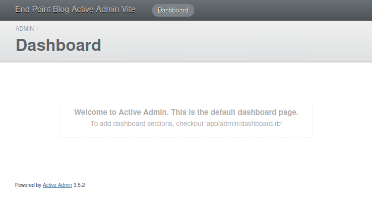
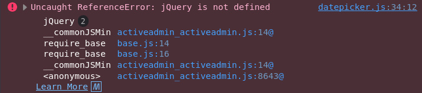
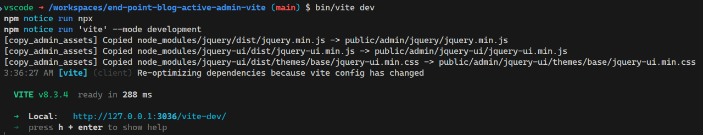
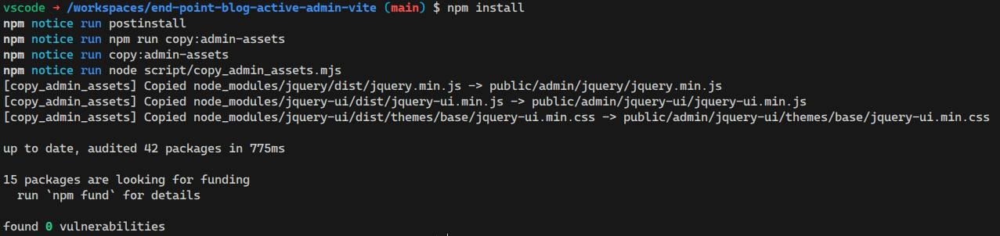
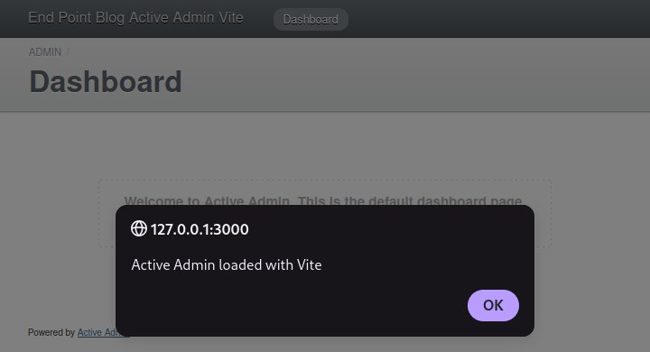
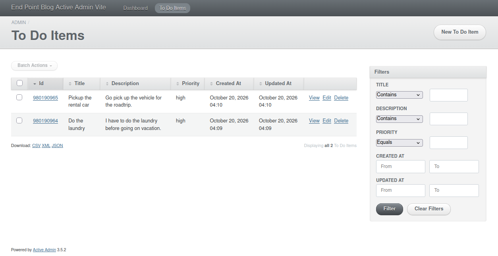

When it comes to frontend development, [Vite](https://vite.dev/) is a great tool. For [Rails](https://rubyonrails.org/) developers, it is a great option thanks to the [Vite Ruby](https://vite-ruby.netlify.app/) project, which makes integrating Vite into Rails codebases a pretty seamless endeavor. What is not completely seamless, however, is using Vite to manage frontend assets for [ActiveAdmin](https://activeadmin.info/).

ActiveAdmin is a legendary framework in the Rails world that makes developing administrative, [CRUD](https://developer.mozilla.org/en-US/docs/Glossary/CRUD)-heavy interfaces very easy. Naturally, ActiveAdmin supports augmenting the behavior of its GUI using JavaScript. However, it does not have built-in support for Vite. So, if your Rails app uses Vite for frontend asset bundling, a few extra pieces of configuration are needed to make it work with assets for ActiveAdmin pages.

In this article, I'll show you how to do it.

## Set up the new project

To demonstrate this, we'll create a simple "to-do list" management app backed by a [PostgreSQL](https://www.postgresql.org/) database.

Let's start by running this:

```sh
rails new . -d postgresql --skip-js
```

Two interesting things about this:

1. We use `-d postgresql` to specify that the app's database will be PostgreSQL.
2. We use `--skip-js` because we will not use any of Rails' built-in options for JavaScript bundling. We will use Vite.

Then we create a model and migration for a single `to_do_items` table:

```sh
bin/rails generate model ToDoItem title:string description:string priority:integer
```

And run the migration:

```sh
bin/rails db:migrate
```

We also define the `priority` enum to make that field a little more friendly:

```rb
class ToDoItem < ApplicationRecord
  enum :priority, { low: 0, medium: 1, high: 2 }
end
```

Next, we download the ActiveAdmin gem:

```sh
bundle add activeadmin
```

And run its installer:

```sh
bin/rails generate active_admin:install --skip-users --skip-comments --use-webpacker
```

A couple of interesting things here:

1. We use `--skip-users` and `--skip-comments` because, for this demo, we don't need authentication or ActiveAdmin comments. This is usually not the case for real-world applications.
2. We include `--use-webpacker` because it sets up the initial config files closer to where we want them for Vite.

At this point, ActiveAdmin is installed, but it does not work. If we run `bin/rails server` and navigate to `http://127.0.0.1:3000/admin`, we'll see an error because we don't yet have a JavaScript bundling mechanism in our asset pipeline. That comes next.

So now we install the `vite_rails` gem with:

```sh
bundle add vite_rails
```

And configure it:

```sh
bundle exec vite install
```

We also need to install ActiveAdmin's client-side library:

```sh
npm install @activeadmin/activeadmin
```

ActiveAdmin uses [SASS](https://sass-lang.com/), which we also want to handle with Vite, so we install a necessary frontend dev-only dependency:

```sh
npm install sass-embedded --save-dev
```

Here's the full list of commands we just ran:

```sh
# Create the rails project
rails new . -d postgresql --skip-js

# Create the to-do item model, migration and table
bin/rails generate model ToDoItem title:string description:string priority:integer
bin/rails db:migrate

# Install and configure ActiveAdmin
bundle add activeadmin
bin/rails generate active_admin:install --skip-users --skip-comments --use-webpacker

# Install and configure Vite
bundle add vite_rails
bundle exec vite install

# Install ActiveAdmin client-side library
npm install @activeadmin/activeadmin

# Install support for SASS
npm install sass-embedded --save-dev
```

With this, we're well on our way to having a running to-do list management app. Let's keep going.

## Configure ActiveAdmin's asset bundling with Vite

Now that we have a solid foundation, let's see what we need to do to have Vite manage ActiveAdmin's frontend assets.

When we ran ActiveAdmin's installer, it created two files: `app/javascript/packs/active_admin.js` and `app/javascript/stylesheets/active_admin.scss`. These are our Vite entry points for JavaScript and CSS, respectively. We need to move both of them to where Vite expects the entry points to be: `app/javascript/entrypoints`. Once there, Vite knows to pick them up, bundle them, and put them in the app's `public` directory, where client browsers can access them.

We also need to modify them slightly, like so:

```diff
 // app/javascript/entrypoints/active_admin.js

 // Active Admin's got SASS!
-@import "~@activeadmin/activeadmin/src/scss/mixins";
-@import "~@activeadmin/activeadmin/src/scss/base";
+@import "@activeadmin/activeadmin/src/scss/mixins";
+@import "@activeadmin/activeadmin/src/scss/base";
```

```diff
 // app/javascript/entrypoints/active_admin.scss

-// Load Active Admin's styles into Webpacker,
-// see `active_admin.scss` for customization.
-import "../stylesheets/active_admin";

 import "@activeadmin/activeadmin";
```

Remember that we passed the `--use-webpacker` option to the `bin/rails generate active_admin:install` command? These modifications are necessary because the generated files only work with [Webpacker](https://github.com/rails/webpacker), not Vite. Essentially, we're changing the paths in some `import` statements and disabling the loading of CSS from JavaScript because we'll load the CSS directly instead.

Now the final piece of the puzzle is to tell ActiveAdmin how to find these bundles produced by Vite. We do this by adding the following to ActiveAdmin's initializer:

```rb
# config/initializers/active_admin.rb

ActiveAdmin.setup do |config|

  # ...

  config.use_webpacker = true

  module ActiveAdminViteJS
    def stylesheet_pack_tag(style, **options)
      style = "active_admin.scss" if style == "active_admin.css"
      vite_stylesheet_tag(style, **options)
    end

    def javascript_pack_tag(script, **options)
      vite_javascript_tag(script, **options)
    end
  end

  ActiveAdmin::Views::Pages::Base.include ActiveAdminViteJS
  ActionView::Base.include ActiveAdminViteJS
end
```

This code tricks ActiveAdmin into thinking that it is working with Webpacker, which makes it call the `stylesheet_pack_tag` and `javascript_pack_tag` helpers in its templates. Webpacker provides these methods to include bundled frontend assets in pages. This code intercepts those calls and uses the Vite helpers instead: `vite_stylesheet_tag` and `vite_javascript_tag`. This is a [pretty clever way](https://activeadmin.info/docs/v3/0-installation.html#vite-rails) to make ActiveAdmin and Vite play nicely together.

## Including other JavaScript libraries

If you run `bin/vite dev` and `bin/rails server` now and navigate to `http://127.0.0.1:3000/admin` in your browser, you'll see what appears to be a working instance of ActiveAdmin:



However, if you look at the browser console, you'll find an error:



ActiveAdmin needs [jQuery](https://jquery.com/), and we haven't installed it. It also needs [jQuery UI](https://jqueryui.com/), but that's no big issue. With Vite, npm, and some clever scripting, we can easily install the libraries explicitly and tell ActiveAdmin to include them on its pages.

First we install jQuery and jQuery UI:

```sh
npm install jquery
npm install jquery-ui
```

Next, we need a way to copy the libraries' files from `node_modules`, where `npm` downloads them, into the app's `public` directory so client browsers can access them. To do that, we create the following script in `script/copy_admin_assets.mjs`:

```js
// script/copy_admin_assets.mjs

import { rmSync, cpSync, mkdirSync } from 'node:fs';
import { dirname } from 'node:path';

const copies = [
  ['node_modules/jquery/dist/jquery.min.js', 'public/admin/jquery/jquery.min.js'],
  ['node_modules/jquery-ui/dist/jquery-ui.min.js', 'public/admin/jquery-ui/jquery-ui.min.js'],
  ['node_modules/jquery-ui/dist/themes/base/jquery-ui.min.css', 'public/admin/jquery-ui/themes/base/jquery-ui.min.css'],
];

for (const [src, dest] of copies) {
  rmSync(dest, { recursive: true, force: true });
  mkdirSync(dirname(dest), { recursive: true });
  cpSync(src, dest, { recursive: true });

  console.log(`[copy_admin_assets] Copied ${src} -> ${dest}`);
}
```

Now we can copy the assets by running `node script/copy_admin_assets.mjs`. It would also be nice to hook this copy operation into a command commonly used during day-to-day development. `bin/vite dev` or `bin/vite build` would be good candidates. We can set this up by modifying `vite.config.ts` as follows:

```diff
# vite.config.ts

+import { execFileSync } from 'node:child_process'
 import { defineConfig } from 'vite'
 import RubyPlugin from 'vite-plugin-ruby'
 
 export default defineConfig({
   plugins: [
+    {
+      name: 'copy-admin-assets',
+      buildStart() {
+        execFileSync(process.execPath, ['script/copy_admin_assets.mjs'], { stdio: 'inherit' })
+      },
+    },
     RubyPlugin(),
   ],

# ...
```

Which results in this:



Alternatively, we could also hook into `npm install` with something like this:

```json
// package.json

{
  // ...

  "scripts": {
    "copy:admin-assets": "node script/copy_admin_assets.mjs",
    "postinstall": "npm run copy:admin-assets"
  },

  // ...
}
```

This looks like this:



Either, or both, can work depending on your workflow. The main idea is to copy the files automatically as part of the build process, so we don't have to run the script manually.

Finally, we add the following configuration to ActiveAdmin's initializer so that it picks up the libraries' files after they are copied into the `public` dir:

```rb
# config/initializers/active_admin.rb

ActiveAdmin.setup do |config|
  # ...

  # == Head
  #
  # You can add your own content to the site head like analytics. Make sure
  # you only pass content you trust.
  #
  # These libraries are loaded as classic <script> tags here (self-hosted under
  # /public/admin, copied from node_modules by `npm run copy:admin-assets`)
  # rather than ESM-bundled through Vite.
  config.head = <<~HTML.html_safe
    <script src="/admin/jquery/jquery.min.js"></script>
    <script src="/admin/jquery-ui/jquery-ui.min.js"></script>
    <link rel="stylesheet" href="/admin/jquery-ui/themes/base/jquery-ui.min.css">
  HTML
end
```

As you can imagine, you can use this same approach for any other JavaScript library intended for browser use that doesn't play nicely with [JavaScript modules](https://developer.mozilla.org/en-US/docs/Web/JavaScript/Guide/Modules), Vite, or bundling.

Now we can finally modify `app/javascript/entrypoints/active_admin.js` and `app/javascript/entrypoints/active_admin.scss` to our heart's content. For example:

```diff
 // app/javascript/entrypoints/active_admin.js

 import "@activeadmin/activeadmin";
+alert("Active Admin loaded with Vite");
```

After running `bin/vite dev` and `bin/rails server`, we get this:



> If you’re using [devcontainers](https://containers.dev/), you may have to specify `127.0.0.1` as the `host` in the Vite dev server configuration (in `config/vite.json`) to allow your browser to connect to it:
>
> ```diff
>  {
>    "all": {
>      "sourceCodeDir": "app/javascript",
>      "watchAdditionalPaths": []
>    },
>    "development": {
>      "autoBuild": true,
>      "skipProxy": true,
>      "publicOutputDir": "vite-dev",
> +    "host": "127.0.0.1",
>      "port": 3036
>    },
>    "test": {
>      "autoBuild": true,
>      "publicOutputDir": "vite-test",
> +    "host": "127.0.0.1",
>      "port": 3037
>    }
>  }
> ```

## CRUDing the To-Do List

That's all I wanted to share today! We have a fully functional admin portal built with Rails, ActiveAdmin, and Vite: a match made in heaven for developer experience and productivity. Before we finish, though, let's savor the fruit of our labor and create a simple CRUD interface for those to-do items.

First, run this:

```sh
bin/rails generate active_admin:resource ToDoItem
```

Then in the generated `app/admin/to_do_items.rb` file, uncomment the `permit_params` line:

```rb
# app/admin/to_do_items.rb

ActiveAdmin.register ToDoItem do
  permit_params :title, :description, :priority
end
```

Finally, add the following to `app/models/to_do_item.rb`:

```rb
class ToDoItem < ApplicationRecord
  enum :priority, { low: 0, medium: 1, high: 2 }

  # Ransack 4+ requires an explicit allowlist for ActiveAdmin searches and sorting.
  # Only these fields are searchable; newly added fields stay private by default.
  def self.ransackable_attributes(auth_object = nil)
    %w[id title description priority created_at updated_at]
  end

  # Ransack also requires an association allowlist. Keep it empty to prevent
  # searches from traversing related models and exposing their data.
  def self.ransackable_associations(auth_object = nil)
    []
  end
end
```

Now we can navigate to `http://127.0.0.1:3000/admin/to_do_items` and see the CRUD screen:


