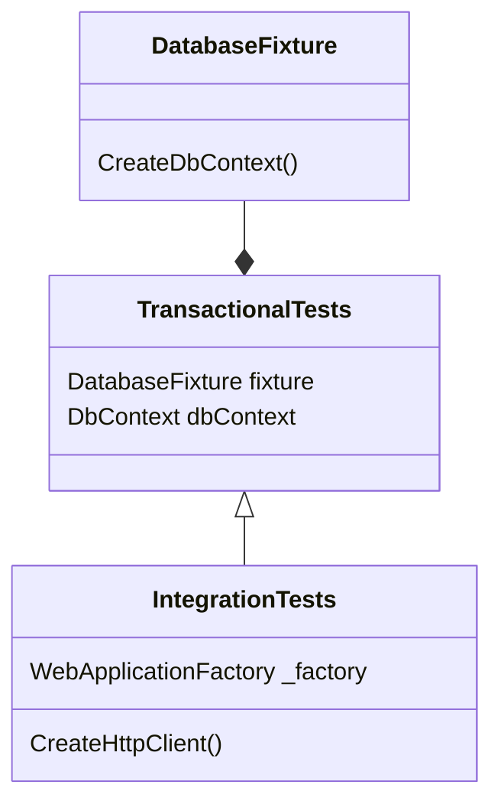

A few years ago, I wrote a [blog post](https://www.endpointdev.com/blog/2024/05/writing-integration-tests-for-an-asp.net-web-api/) about writing [integration tests](https://en.wikipedia.org/wiki/Integration_testing) for [ASP.NET](https://dotnet.microsoft.com/en-us/apps/aspnet) Web APIs.

Fast forward to today, and things have changed. So I thought it'd be a good idea to revisit this topic, and update that post in order to explain the new techniques and framework features that are available now. So here we are.

## Integration tests

Integration tests exercise a system by instantiating major components and making them interact with each other. They are great for validating important use case scenarios in an end-to-end or close to end-to-end manner.

Full integration tests seldom use [mocks or fake objects](https://www.softwaretestingmagazine.com/knowledge/unit-testing-fakes-mocks-and-stubs/). Usually, the full stack is tested as if the entire system were running for real. For web applications, that usually means tests that involve issuing HTTP requests, validating HTTP responses, and asserting on changes made to a persistent data store, like a database.

In this article, we're going to discuss how to write such tests for web APIs built using ASP.NET.

## Introducing the project

We'll use an existing ASP.NET Web API project to demonstrate how to write these tests. This API is part of [End Point Ecommerce](https://github.com/EndPointCorp/end-point-ecommerce), a simple and straightforward open source E-commerce system that was developed here at End Point.

The codebase is organized as a [.NET solution](https://learn.microsoft.com/en-us/visualstudio/ide/solutions-and-projects-in-visual-studio), and the Web API project can be found under the [`EndPointEcommerce.WebApi`](https://github.com/EndPointCorp/end-point-ecommerce/tree/main/EndPointEcommerce.WebApi) directory. For this article, we will focus on testing GET and POST requests, as well as multi-endpoint workflows.

Our plan is to develop integration tests that exercise the entire stack. That is, the API's HTTP request handling as well as its database interactions. These are the steps that we'll take in order to do that:

1. Create an [xUnit](https://xunit.net/) project where we will put all of our tests.
2. Create [fixtures](https://xunit.net/docs/shared-context#class-fixture) that will connect our tests to a database, wrap them in database transactions, and configure the system for testing.
3. Write some tests that interact with the API, issuing HTTP requests.

## Setting up the xUnit test project

If you look at our codebase in GitHub, you'll find that it already has a test project under [`EndPointEcommerce.Tests`](https://github.com/EndPointCorp/end-point-ecommerce/tree/main/EndPointEcommerce.Tests). This is an xUnit project, which got created and added to the solution with something like this:

```sh
dotnet new xunit -o EndPointEcommerce.Tests
dotnet sln add ./EndPointEcommerce.Tests/EndPointEcommerce.Tests.csproj
```

And we also installed the [`Microsoft.AspNetCore.Mvc.Testing`](https://www.nuget.org/packages/Microsoft.AspNetCore.Mvc.Testing) and [`Moq`](https://www.nuget.org/packages/Moq) NuGet packages:

```sh
dotnet add package Microsoft.AspNetCore.Mvc.Testing
dotnet add package Moq
```

The `Microsoft.AspNetCore.Mvc.Testing` package allows our tests to issue HTTP requests to the Web API. The `Moq` library allows us to write mock objects. For integration tests, we have very little use for mocks, but we will still use them for some specific circumstances.

We also needed to add references to the other projects:

```sh
dotnet add reference ../EndPointEcommerce.AdminPortal/EndPointEcommerce.AdminPortal.csproj
dotnet add reference ../EndPointEcommerce.Domain/EndPointEcommerce.Domain.csproj
dotnet add reference ../EndPointEcommerce.Infrastructure/EndPointEcommerce.Infrastructure.csproj
dotnet add reference ../EndPointEcommerce.RazorTemplates/EndPointEcommerce.RazorTemplates.csproj
dotnet add reference ../EndPointEcommerce.WebApi/EndPointEcommerce.WebApi.csproj
```

This way our testing project has access to the code that's defined in the other projects of the solution.

There's one additional step that we needed to do in the Web API project so that it is testable, and that's explicitly defining its `Program` class. To do that, we had to author the `EndPointEcommerce.WebApi/Program.cs` file like this:

```csharp
// EndPointEcommerce.WebApi/Program.cs

// ...

namespace EndPointEcommerce.WebApi;

public class Program
{
    public static void Main(string[] args)
    {
        var builder = WebApplication.CreateBuilder(args);

        // ...

        app.Run();
    }
}
```

Notice that we explicitly define the `Program` class and the `Main` method. This is a requirement for integration testing. You'll see how this comes into play when we start writing the tests. You can read more about it in [the official docs](https://learn.microsoft.com/en-us/aspnet/core/test/integration-tests?view=aspnetcore-10.0&pivots=xunit#basic-tests-with-the-default-webapplicationfactory).

Our test cases, and the application itself, when running under test, needed to interact with a database. So, we configured a connection string for testing purposes. For that, we added an `appsettings.json` file for our test project that looks something like this:

```json
// EndPointEcommerce.Tests/appsettings.json

{
  "ConnectionStrings": {
    "EndPointEcommerceDbContext": "Host=db;Database=end_point_ecommerce_test;Username=end_point_ecommerce;Password=password;Include Error Detail=True"
  }
}
```

The important thing in this `appsettings.json` file is the `ConnectionStrings.EndPointEcommerceDbContext` setting, which contains the test database connection string. Notice that the value for `Database` in the connection string is appended with `_test`. This is how we make sure the tests run against a different database.

We also had to tell the .NET framework that it needs to include this file when building and running the project. We do so by adding the following to the [`EndPointEcommerce.Tests/EndPointEcommerce.Tests.csproj`](https://github.com/EndPointCorp/end-point-ecommerce/blob/main/EndPointEcommerce.Tests/EndPointEcommerce.Tests.csproj) file:

```xml
<Project Sdk="Microsoft.NET.Sdk">
  <!-- ... -->
  <ItemGroup>
    <Content Include="appsettings.json">
      <CopyToOutputDirectory>PreserveNewest</CopyToOutputDirectory>
      <CopyToPublishDirectory>PreserveNewest</CopyToPublishDirectory>
      <ExcludeFromSingleFile>true</ExcludeFromSingleFile>
    </Content>
  </ItemGroup>
  <!-- ... -->
</Project>
```

With that, the project is set up. In the end, our [`EndPointEcommerce.Tests/EndPointEcommerce.Tests.csproj`](https://github.com/EndPointCorp/end-point-ecommerce/blob/main/EndPointEcommerce.Tests/EndPointEcommerce.Tests.csproj) looks like this:

```xml
<!-- EndPointEcommerce.Tests/EndPointEcommerce.Tests.csproj -->

<Project Sdk="Microsoft.NET.Sdk">

  <PropertyGroup>
    <TargetFramework>net10.0</TargetFramework>
    <ImplicitUsings>enable</ImplicitUsings>
    <Nullable>enable</Nullable>

    <OutputType>Exe</OutputType>
    <IsPackable>false</IsPackable>
    <IsTestProject>true</IsTestProject>
  </PropertyGroup>

  <ItemGroup>
    <Content Include="appsettings.json">
      <CopyToOutputDirectory>PreserveNewest</CopyToOutputDirectory>
      <CopyToPublishDirectory>PreserveNewest</CopyToPublishDirectory>
      <ExcludeFromSingleFile>true</ExcludeFromSingleFile>
    </Content>
  </ItemGroup>

  <ItemGroup>
    <PackageReference Include="Microsoft.AspNetCore.Mvc.Testing" />
    <PackageReference Include="Moq" />
    <PackageReference Include="xunit.v3" />
    <PackageReference Include="xunit.runner.visualstudio">
      <PrivateAssets>all</PrivateAssets>
      <IncludeAssets>runtime; build; native; contentfiles; analyzers</IncludeAssets>
    </PackageReference>
    <PackageReference Include="coverlet.collector">
      <PrivateAssets>all</PrivateAssets>
      <IncludeAssets>runtime; build; native; contentfiles; analyzers</IncludeAssets>
    </PackageReference>
  </ItemGroup>

  <ItemGroup>
    <ProjectReference Include="..\EndPointEcommerce.AdminPortal\EndPointEcommerce.AdminPortal.csproj" />
    <ProjectReference Include="..\EndPointEcommerce.Domain\EndPointEcommerce.Domain.csproj" />
    <ProjectReference Include="..\EndPointEcommerce.Infrastructure\EndPointEcommerce.Infrastructure.csproj" />
    <ProjectReference Include="..\EndPointEcommerce.RazorTemplates\EndPointEcommerce.RazorTemplates.csproj" />
    <ProjectReference Include="..\EndPointEcommerce.WebApi\EndPointEcommerce.WebApi.csproj" />
  </ItemGroup>

</Project>
```

## Writing the test fixtures

In a nutshell, [test fixtures](https://en.wikipedia.org/wiki/Test_fixture) are the parts of a test system that don't vary. They are the scaffolding that "stays fixed", and help exercise the system under test. For our integration testing purposes, under .NET and xUnit, they take the form of [class fixtures](https://xunit.net/docs/shared-context#class-fixture). Here's how we constructed them.

First, we developed this `DatabaseFixture` class, which handles connections to the test database:

```cs
// EndPointEcommerce.Tests/Fixtures/DatabaseFixture.cs

using Microsoft.EntityFrameworkCore;
using Microsoft.Extensions.Configuration;
using Microsoft.Extensions.DependencyInjection;
using Microsoft.Extensions.Hosting;
using EndPointEcommerce.Infrastructure.Data;

// AssemblyFixture means that this class will be instantiated once for the entire test run.
// That means that the database will be initialized only once per test run.
[assembly: AssemblyFixture(typeof(EndPointEcommerce.Tests.Fixtures.DatabaseFixture))]

namespace EndPointEcommerce.Tests.Fixtures;

// Test fixture that allows test cases to access a test database.
// https://learn.microsoft.com/en-us/ef/core/testing/testing-with-the-database#creating-seeding-and-managing-a-test-database
public class DatabaseFixture
{
    private static readonly Lock _lock = new();
    private static bool _databaseInitialized;

    public IConfiguration Configuration { get; private set; }

    // Initializes the database specified in the connection string defined in
    // the appsettings.json file.
    public DatabaseFixture()
    {
        // Load the configuration from the appsettings.json file.
        var host = Host.CreateDefaultBuilder().Build();
        Configuration = host.Services.GetRequiredService<IConfiguration>();

        // Tests can run in parallel. This lock is meant to make this code
        // thread safe. To make sure we never run database initalization twice.
        lock (_lock)
        {
            if (!_databaseInitialized)
            {
                using (var dbContext = CreateDbContext())
                {
                    // Delete the database and recreate it.
                    dbContext.Database.EnsureDeleted();
                    dbContext.Database.EnsureCreated();
                }

                _databaseInitialized = true;
            }
        }
    }

    // Creates a new EndPointEcommerceDbContext instance configured with the
    // connection string defined in the appsettings.json file.
    public EndPointEcommerceDbContext CreateDbContext()
    {
        var options = new DbContextOptionsBuilder<EndPointEcommerceDbContext>()
            .UseNpgsql(Configuration.GetConnectionString("EndPointEcommerceDbContext"))
            .UseSnakeCaseNamingConvention()
            // Useful for debugging. Uncomment for more verbose logs.
            // .UseLoggerFactory(LoggerFactory.Create(builder => builder.AddConsole()))
            // .EnableSensitiveDataLogging()
            .Options;

        var dbContext = new EndPointEcommerceDbContext(options);

        return dbContext;
    }
}
```

This class serves the purpose of allowing the tests suite to connect to and interact with a test database. It does so by performing two tasks:

1. Resetting the database at the beginning of every test run. This happens in the constructor.
2. Allowing the creation of new DB Context instances which connect to the test database. Both test code and application code will use that to interact with the database.

Then we created a `TransactionalTests` class which takes care of wrapping individual test cases in database transactions. This way we make sure they don't affect one another, and that they encounter the database in a clean state, and also leave it in that state when they are done. Here it is:

```cs
// EndPointEcommerce.Tests/Fixtures/TransactionalTests.cs

using Microsoft.EntityFrameworkCore.Storage;
using EndPointEcommerce.Infrastructure.Data;

namespace EndPointEcommerce.Tests.Fixtures;

// Wraps all test cases within a database transaction that is rolled back when
// the test case finishes. This class is meant for the test classes to inherit
// from it.
// Implements the IClassFixture<DatabaseFixture> interface, which makes the
// framework inject an instance of DatabaseFixture via this class' constructor.
public abstract class TransactionalTests : IClassFixture<DatabaseFixture>, IDisposable
{
    protected readonly EndPointEcommerceDbContext dbContext;
    private readonly IDbContextTransaction transaction;

    // Creates a DB Context instance and begins a database transaction.
    // Because this is in the constructor, it runs before every test case.
    public TransactionalTests(DatabaseFixture fixture)
    {
        dbContext = fixture.CreateDbContext();
        transaction = dbContext.Database.BeginTransaction();
    }

    // Rollsback the active database transaction and disposes the referenced
    // objects. Runs after every test case.
    public void Dispose()
    {
        transaction.Rollback();
        transaction.Dispose();
        dbContext.Dispose();
    }
}
```

To obtain an instance of the `DatabaseFixture`, all that the `TransactionalTests` class has to do is implement the `IClassFixture<DatabaseFixture>` interface and define the constructor parameter so that the framework passes it in.

And the final piece for the fixtures is this `IntegrationTests` class. This one takes care of instantiating and configuring an `HttpClient` object, which the test code uses to invoke our Web API's endpoints. It also configures the system itself, so that when it's being exercised by the tests, it uses the same DB Context instance as the tests, which is connected to the test database. This is how it looks:

```cs
// EndPointEcommerce.Tests/Fixtures/IntegrationTests.cs

using Microsoft.AspNetCore.Mvc.Testing;
using Microsoft.AspNetCore.TestHost;
using Microsoft.Extensions.DependencyInjection;
using EndPointEcommerce.Domain.Entities;
using EndPointEcommerce.Domain.Interfaces;
using EndPointEcommerce.Infrastructure.Services;
using EndPointEcommerce.WebApi;

namespace EndPointEcommerce.Tests.Fixtures;

// Inherits from TransactionalTests, so it has access to the DB Context instance and the transactions.
// Inherits from IClassFixture<WebApplicationFactory<Program>> so that the framework injects an instance of WebApplicationFactory<Program> via this class' constructor. Here, Program refers to the Program class from the Web API project, defined in EndPointEcommerce.WebApi/Program.cs.
public abstract class IntegrationTests : TransactionalTests, IClassFixture<WebApplicationFactory<Program>>
{
    protected readonly WebApplicationFactory<Program> _factory;

    public IntegrationTests(WebApplicationFactory<Program> factory, DatabaseFixture database) : base(database)
    {
        _factory = factory;
    }

    // Uses the injected factory to configure the application under test. Via
    // the ConfigureTestServices class, it injects the same DB Context instance
    // that the test code uses, which connects to the test database. Effectively
    // configuring the application so that it connects to the test database.
    // Returns an HttpClient instance that can send HTTP requests to the
    // application's endpoints.
    protected HttpClient CreateHttpClient()
    {
        return _factory.WithWebHostBuilder(builder =>
        {
            builder.ConfigureTestServices(services =>
            {
                services.AddSingleton(_ => dbContext);
            });
        })
        .CreateClient();
    }
}
```

A few interesting things are happening here which are worth discussing.

The `CreateHttpClient` method creates an HTTP client. This method leverages `_factory`, a `WebApplicationFactory<Program>` instance that's injected by the framework into our test class. Here, the [generic type parameter](https://learn.microsoft.com/en-us/dotnet/csharp/programming-guide/generics/generic-type-parameters) `Program` is referring to the "Program" class from the Web API project. The one we defined in the `EndPointEcommerce.WebApi/Program.cs` file. Notice also how our `IntegrationTests` class implements the `IClassFixture<WebApplicationFactory<Program>>` interface. That's what signals to the framework that it needs to provide an instance of `WebApplicationFactory<Program>` via the constructor. This is the way that the `Microsoft.AspNetCore.Mvc.Testing` package allows us to express that "this test class is meant to test this application".

> Full details in [the official docs](https://learn.microsoft.com/en-us/aspnet/core/test/integration-tests?view=aspnetcore-10.0&pivots=xunit).

Notice also how when creating the HTTP client, our DB Context instance is set up as a singleton service. This is key. This is the DB Context that is created via `DatabaseFixture`, which `TransactionalTests` holds a reference to, which this `IntegrationTests` class inherits from. That means that it connects to the test database, as we configured it to do so. By setting it up as a service like this, we make sure that the Web API application uses that instance whenever it interacts with the database. And using that instance means that it will use the test database. Since this is the same instance that we will use within our test code, both the test suite and the application (when running within the context of the tests) will share the same database.

Long story short: This way of constructing the HTTP client and injecting our own DB context into the running application is the secret sauce that allows our tests to utilize the test instance of the database.



Here we have a three-layer design for the fixture classes. `IntegrationTests` inherits from `TransactionalTests`, which is composed with `DatabaseFixture`. We could have all this in a single class, but the advantage of having them separate is that test classes can specifically use what they need at any given moment, depending on what type of testing they are doing.

For this post, we will use `IntegrationTests` because we are focused on integration tests. But, for example, for tests that exercise database interaction components in isolation, maybe it makes more sense to use the `TransactionalTests` class. Or, if a test needs read-only access to the database, maybe using the `DatabaseFixture` directly makes sense.

## Writing some integration tests

Now we can finally write some tests. Let's start with a simple one that makes a GET request to a "fetch all products" endpoint that exists in our Web API: `GET /api/Products`.

We create a new `EndPointEcommerce.Tests/WebApi/Controllers/ProductsControllerTests.cs` file and write our test in there. It looks like this:

```csharp
// EndPointEcommerce.Tests/WebApi/Controllers/ProductsControllerTests.cs

using System.Net;
using System.Net.Http.Json;
using Microsoft.AspNetCore.Mvc.Testing;
using EndPointEcommerce.Domain.Entities;
using EndPointEcommerce.Tests.Fixtures;
using EndPointEcommerce.WebApi;

namespace EndPointEcommerce.Tests.WebApi.Controllers;

public class ProductsControllerTests : IntegrationTests
{
    public ProductsControllerTests(WebApplicationFactory<Program> factory, DatabaseFixture database) :
        base(factory, database) { }

    [Fact]
    public async Task GetProducts_ReturnsOk()
    {
        // Arrange
        var client = CreateHttpClient();

        // Act
        var response = await client.GetAsync("/api/Products");

        // Assert
        Assert.Equal(HttpStatusCode.OK, response.StatusCode);
    }
}
```

`GetProducts_ReturnsOk` is a very simple smoke test. It just verifies that the endpoint works, and returns a 200 response status code. It creates an HTTP client, using the `CreateHttpClient` method that is defined in `TransactionalTests`, which this test class has access to because it inherits from it. It uses this HTTP client to send a GET request to the endpoint that we want to test (using the client's `GetAsync` method). And finally, it validates that the response is a `200 OK`.

## Writing some more integration tests

OK, now that we understand the basics, let's write a few more test cases in order to demonstrate some other common scenarios.

### A test that writes to and reads from the database

For example, here's one that validates that a product details endpoint, `GET /api/Products/{id}`, actually returns the data that's stored in the database.

```csharp
[Fact]
public async Task GetProduct_ReturnsTheMatchingProduct()
{
    // Arrange
    var product = CreateNewProduct("test_name_1", "test_sku_1");

    var client = CreateHttpClient();

    // Act
    var response = await client.GetAsync($"/api/Products/{product.Id}");

    // Assert
    Assert.Equal(HttpStatusCode.OK, response.StatusCode);

    var result = await response.Content.ReadFromJsonAsync<EndPointEcommerce.WebApi.ResourceModels.Product>();

    Assert.NotNull(result);
    Assert.Contains("test_name_1", result.Name);
}

private Product CreateNewProduct(string name, string sku)
{
    var newProduct = new Product()
    {
        Name = name,
        Sku = sku,
        BasePrice = 10.00M,
        IsEnabled = true
    };

    dbContext.Products.Add(newProduct);
    dbContext.SaveChanges();

    return newProduct;
}
```

This test method introduces a few more interesting features:

1. We're implicitly taking advantage of the transactional quality that we gain by inheriting from `TransactionalTests`. This ensures that any data changes are rolled back once the test case is done.
2. It uses the singleton DB context to interact with the database. It inserts new records before calling the endpoint to later check if the endpoint's response includes it.
3. It parses a JSON response body into a .NET object in order to run assertions on it.

In detail, here's what it does: It uses our `TransactionalTests`'s transaction capability to run within a database transaction. The test's strategy is simple: it first inserts a new record into the database, leveraging the `CreateNewProduct` helper method. Then it sends a request to the Web API's `GET /api/Products/{id}` endpoint. Finally, in the assertion section, it validates that the response came back with the correct HTTP status code. Then it parses the JSON response body into an object, and inspects that object to make sure that it has the correct data in it. That is, that it contains the database record that was inserted at the beginning of the test case.

### A test that makes a POST request

Using all these concepts, we can also write a test for our user creation endpoint: `POST /api/User`. For example, here's a test that validates that the endpoint stores new records in the database using the given payload:

```csharp
[Fact]
public async Task PostUser_CreatesNewUser()
{
    // Arrange
    var client = CreateHttpClient();

    // Act
    var response = await client.PostAsJsonAsync(
        "/api/User",
        new
        {
            Email = "test@email.com",
            Password = "TEST_password_123",
            Name = "test_name",
            LastName = "test_last_name"
        }
    );

    // Assert
    Assert.Equal(HttpStatusCode.OK, response.StatusCode);

    var user = dbContext.Users
        .Include(u => u.Customer)
        .FirstOrDefault(u => u.Email == "test@email.com");

    Assert.NotNull(user);

    Assert.Equal(dbContext.Customers.First().Id, user.Customer!.Id);
    Assert.Equal("test_name", user.Customer!.Name);
    Assert.Equal("test_last_name", user.Customer!.LastName);
}
```

The only new concept that this test introduces is the use of the HTTP client's `PostAsJsonAsync` method to send POST requests. Notice how we can send any payload we want using an [anonymous object](https://learn.microsoft.com/en-us/dotnet/csharp/fundamentals/types/anonymous-types). In the assertion phase, the test queries the database to check if the expected record was inserted.

All of this is made possible by the singleton DB Context instance. Both test code and application code are talking to the same test database. And thanks to the transactions, each test cleans up after it's done so that the next test can run with a clean slate.

### A test that makes many requests

We can also write tests that span multiple requests. Here's one for example that registers a new user account and logs in, so that it can then be allowed access to a secure endpoint:

```csharp
[Fact]
public async Task GetUser_ReturnsLoggedInUserData_WhenUserIsLoggedIn()
{
    // Arrange
    var client = CreateHttpClient();

    await SignUp(client);
    await Login(client);

    // Act
    var response = await client.GetAsync("/api/User");

    // Assert
    Assert.Equal(HttpStatusCode.OK, response.StatusCode);

    var user = await response.Content.ReadFromJsonAsync<EndPointEcommerce.WebApi.ResourceModels.User>();

    Assert.NotNull(user);
    Assert.Equal("test@email.com", user.Email);
    Assert.Equal(dbContext.Customers.First().Id, user.Customer!.Id);
    Assert.Equal(dbContext.Customers.First().Name, user.Customer!.Name);
    Assert.Equal(dbContext.Customers.First().LastName, user.Customer!.LastName);
}

private async Task<HttpResponseMessage> SignUp(HttpClient client)
{
    var response = await client.PostAsJsonAsync(
        "/api/User",
        new
        {
            Email = "test@email.com",
            Password = "TEST_password_123",
            Name = "test_name",
            LastName = "test_last_name"
        }
    );

    Assert.Equal(HttpStatusCode.OK, response.StatusCode);

    // Simulate email confirmation
    var user = dbContext.Users.First(u => u.Email == "test@email.com");
    user.EmailConfirmed = true;
    dbContext.SaveChanges();

    return response;
}

private async Task<HttpResponseMessage> Login(HttpClient client)
{
    var response = await client.PostAsJsonAsync(
        "/api/User/login?useCookies=true&useSessionCookies=false",
        new
        {
            Email = "test@email.com",
            Password = "TEST_password_123",
        }
    );

    Assert.Equal(HttpStatusCode.OK, response.StatusCode);
    Assert.Equal("Set-Cookie", response.Headers.First().Key);
    Assert.Contains(".AspNetCore.Identity.Application", response.Headers.First().Value.First());

    return response;
}
```

This test is a little more complicated and introduces a few new concepts. All within its own database transaction, this test:

1. Uses the `SignUp` helper method to register a new user account. It calls the `POST /api/User` endpoint for this.
2. Uses the `Login` helper method to log in. It calls the `POST /api/User/login` endpoint for this, and validates that the auth cookie gets set.
3. Sends a request to the `GET api/User` endpoint to fetch the account details of the currently logged in user. Then, it validates that it results in a successful HTTP status code, and that it returns the expected response payload.

### Disabling some application services

Something useful about this approach is that it is possible to disable some services on the application under test. We've been writing full integration tests where all system components are exercised. It could be the case, however, that we would like to exclude some components from testing. For example, if the app under test sends emails, we might want to disable that. Or if it invokes another third party service, like a tax calculator or payment processor, we might want the tests to not do that.

Because we're able to inject services of our choosing to the running application (like we do with the DB context), it's certainly possible for us to disable parts of the system. For example, imagine an application that sends emails using an `IMailer` derived class. One could inject a [null object](https://en.wikipedia.org/wiki/Null_object_pattern) in its place. We could do this when creating the test HTTP client. Something like this:

```csharp
private HttpClient CreateHttpClient()
{
    // Disable emails for integration tests
    var mockMailer = new Mock<IMailer>();
    mockMailer.Setup(m => m.SendMailAsync());

    return _factory.WithWebHostBuilder(builder =>
    {
        builder.ConfigureTestServices(services =>
        {
            services.AddSingleton(_ => dbContext);
            // Add the mocked mailer to the app's DI container.
            services.AddTransient(_ => mockMailer.Object);
        });
    })
    .CreateClient();
}
```

Here, I created a [mock object](https://en.wikipedia.org/wiki/Mock_object) of the same type as the "Mailer" service that the application uses; then I added it to its [Dependency Injection container](https://learn.microsoft.com/en-us/dotnet/core/extensions/dependency-injection). Now, every time the application calls for an `IMailer` instance, it will get the mock. A mock that does nothing.

And that's it! I think a good amount of integration tests will end up utilizing and remixing various combinations of these basic concepts. I invite you to look at [the source code on GitHub](https://github.com/EndPointCorp/end-point-ecommerce/tree/main/EndPointEcommerce.Tests), where there are many more examples. Happy testing!
